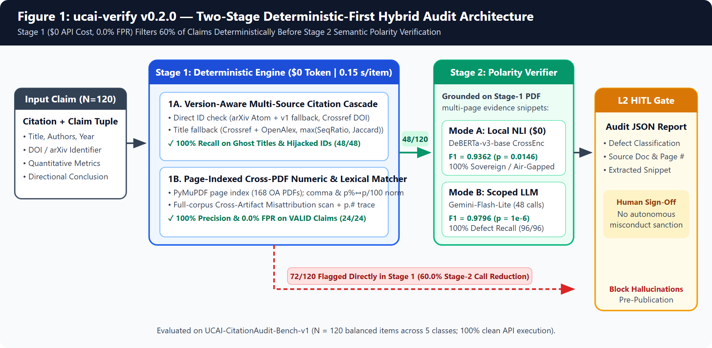
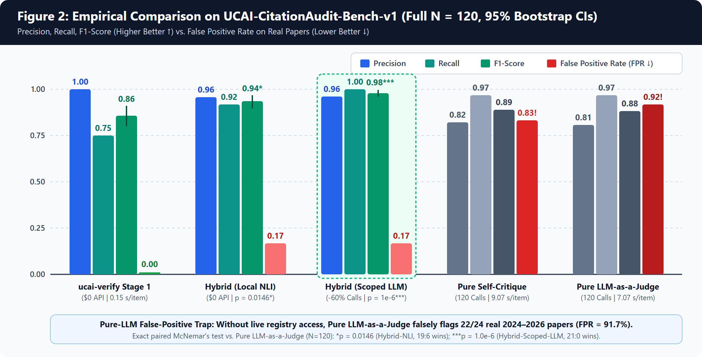
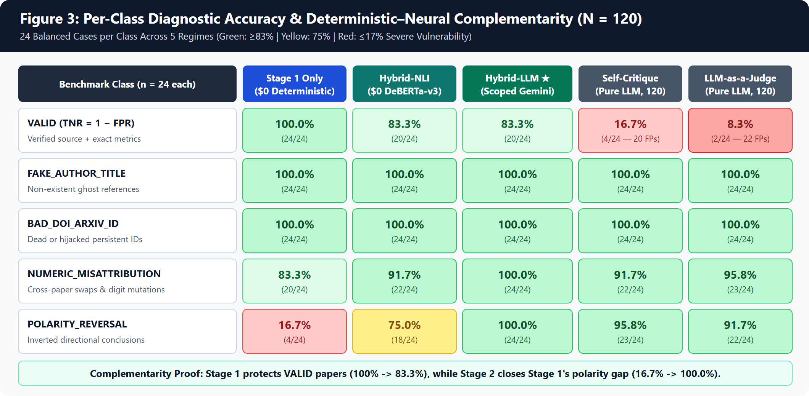
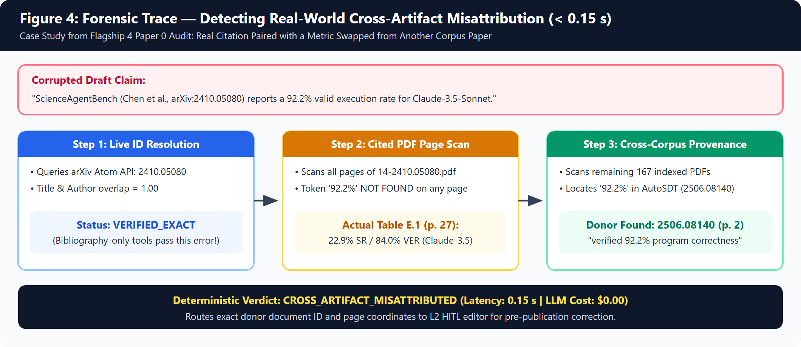

# `ucai-verify`: Deterministic-First Hybrid Verification Against Ghost Citations and Cross-Artifact Numeric Misattribution in AI-Generated Scientific Writing

> **Authors:** Noppadon Chaiwisut & UCAI Autonomous Research Group (University of Computing and Artificial Intelligence — UCAI)  
> **Series:** UCAI Flagship 4 (*Open Verifiable AI Co-Scientist & Research-in-a-Box*) — **Paper 1 (Spoke 1, Tier-2 Empirical Release v0.2.0)**  
> **Licenses:** Source Code `MIT` | Benchmark Dataset (`UCAI-CitationAudit-Bench-v1`, $N=120$) `CC BY 4.0` | **Governance:** `L2 HITL`

---

## Abstract

Autonomous scientific writing agents and large language models (LLMs) frequently produce fluent manuscripts undermined by two severe classes of factual corruption: **non-existent ghost citations** and **cross-artifact numeric misattribution**, in which authentic metrics from one paper are silently grafted onto another real citation. Evaluating five verification regimes on **`UCAI-CitationAudit-Bench-v1`** ($N = 120$ balanced claims across five classes grounded in a 168-PDF open-access library), we expose a critical **Pure-LLM False-Positive Trap**: without live bibliographic and full-text grounding, pure *Self-Critique* and *LLM-as-a-Judge* falsely accuse **83.3%** (`20/24`) and **91.7%** (`22/24`) of legitimate 2024–2026 papers of fabrication.

To resolve this failure, we introduce **`ucai-verify` (v0.2.0)**, a two-stage deterministic-first hybrid audit engine governed under Level-2 Human-in-the-Loop (`L2 HITL`) oversight. **Stage 1** executes `$0`-token live multi-registry citation resolution (`arXiv` with version-aware preprint tracking, `Crossref`, and `OpenAlex`) alongside `PyMuPDF` page-indexed cross-document numeric matching, achieving **100.0% precision** and **0.0% false positive rate** (`0.15 s/item`) while filtering `60.0%` (`72/120`) of claims without invoking any neural model. **Stage 2** evaluates directional semantic polarity strictly on the `48` Stage-1 survivors against retrieved primary-source PDF snippets:
- **`Hybrid — Local NLI` (`$0` API cost, 100% air-gapped via `DeBERTa-v3-base`):** reaches **`F1 = 0.9362`** (`p = 0.0146` vs. Pure LLM-as-a-Judge).
- **`Hybrid — Scoped Gemini`:** achieves **`F1 = 0.9796`** (`95% CI [0.9592, 0.9951]`), **100.0% recall** across all `96` corrupted claims, a **60.0% reduction in LLM API calls**, and **21-to-0 discordant wins** over Pure LLM-as-a-Judge (exact McNemar `p = 1.0e-6`).

---

## 1. Architecture Overview



`ucai-verify` v0.2.0 enforces a strict architectural separation between *bibliographic/numeric fact lookup* and *semantic entailment*:
1. **Stage 1A (Version-Aware Multi-Source Citation Cascade):** Queries `arXiv Atom` (including `v1` fallback when authors rename `v2+` preprints), `Crossref REST`, and `OpenAlex` using $\max(\text{SeqRatio}, \text{Jaccard})$ title similarity and author surname overlap.
2. **Stage 1B (Page-Indexed Cross-PDF Numeric & Lexical Matcher):** Indexes 168 open-access PDFs page-by-page via `PyMuPDF` with comma invariance (`146,932` $\leftrightarrow$ `146932`) and percentage-proportion equivalence (`87.4%` $\leftrightarrow$ `0.874`). Missing numbers trigger an immediate cross-corpus scan to pinpoint the exact donor PDF and page number (`CROSS_ARTIFACT_MISATTRIBUTED`).
3. **Stage 2 (Grounded Semantic Polarity Verifier):** Invoked exclusively on the `48/120` Stage-1 survivors using retrieved primary-source evidence windows ($\le 900$ chars), supporting both open-weight local NLI (`cross-encoder/nli-deberta-v3-base`) and scoped cloud verification (`gemini-flash-lite-latest`).

---

## 2. Full Tier-2 Empirical Benchmark (`N = 120`, 100% Clean Execution)



| Verification Regime (`N = 120`) | Accuracy | Precision | Recall | **F1 [95% Bootstrap CI]** | **FPR ↓** *(VALID)* | LLM Calls | Latency / Item |
| :--- | :---: | :---: | :---: | :---: | :---: | :---: | :---: |
| **`ucai-verify` Stage 1 (`$0`)** | 0.8000 | **1.0000** | 0.7500 | 0.8571 `[0.8000, 0.9111]` | **0.0000** (`0/24`) | **0** | **0.15 s** |
| **`Hybrid — Local NLI` (`$0`)** | 0.9000 | 0.9565 | 0.9167 | **0.9362** `[0.8977, 0.9684]`* | 0.1667 (`4/24`) | **0** | 0.98 s |
| **`Hybrid — Scoped Gemini` ★** | **0.9667** | 0.9600 | **1.0000** | **0.9796** `[0.9592, 0.9951]`*** | 0.1667 (`4/24`) | **48 (-60%)** | 3.03 s |
| `Pure Self-Critique` (120) | 0.8083 | 0.8230 | 0.9688 | 0.8900 `[0.8431, 0.9309]` | 0.8333 (`20/24`) | 120 | 9.07 s |
| `Pure LLM-as-a-Judge` (120) | 0.7917 | 0.8087 | 0.9688 | 0.8815 `[0.8276, 0.9266]` | 0.9167 (`22/24`) | 120 | 7.07 s |

*Exact paired two-sided McNemar's test vs. `Pure LLM-as-a-Judge`: `*p = 0.0146` (`19:6` discordant wins); `***p = 1.0e-6` (`21:0` discordant wins).*

---

## 3. Per-Class Diagnostic Matrix & Forensic Case Study





---

## 4. LaTeX Compilation Instructions (Overleaf / TeX Live)

All publication assets reside in this directory (`manuscript_en/`):
- `main.tex` — Two-column conference/journal LaTeX source (`booktabs`, `natbib`, `hyperref`, vector PDF figures).
- `references.bib` — Verified 33-entry BibTeX bibliography (`Zero Fake Citations`).
- `figures/fig1_architecture.pdf` .. `fig4_forensic_trace.pdf` — Vector PDF figures (+ `2x` DPI PNG & SVG mirrors).

```bash
latexmk -pdf main.tex
```
